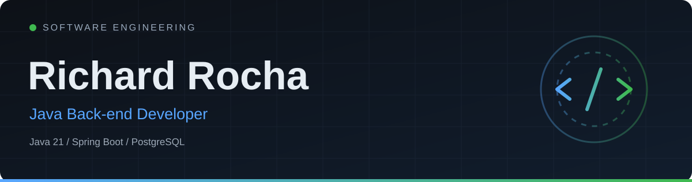
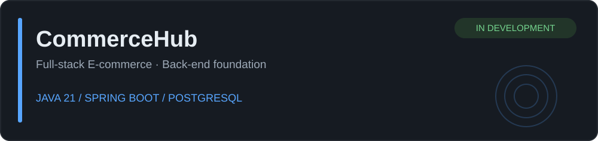

 

**Software Engineering Student · Java Back-end Developer**

Building back-end systems with **Java**, **Spring Boot** and **PostgreSQL**.

---

### About me

I'm a Software Engineering student focused on **Java back-end development**. I'm interested in REST API design, relational databases, software architecture and building maintainable applications. I learn by applying engineering fundamentals to real projects and reviewing technical trade-offs.

Currently pursuing my **first Junior Java Back-end Developer opportunity in Brazil**, with a long-term goal of working internationally.

### Tech stack & tools

**Back-end**

  
  

**Database & migrations**

  
  

**Front-end**

  
  
  
  

**Tools & environment**

  
  
  
  

REST APIs · SQL · Maven · GitHub

### Featured project

**[CommerceHub — Source Code](https://github.com/rocharichard061/commercehub)**

An evolving full-stack e-commerce project. Its back-end foundation uses **Java 21**, **Spring Boot**, **Maven**, with dependencies for **PostgreSQL**, **Spring Data JPA**, **Flyway** and validation. **React** is part of the intended full-stack architecture.

> **Status:** In development. The public repository currently contains the Spring Boot project foundation. Business features, completed API endpoints, payment integration and deployment are not yet claimed as implemented.

**Focus areas:** relational data modeling · API design · maintainability · application architecture

### Engineering interests

`Back-end Architecture` · `REST API Design` · `Database Modeling` · `Clean Code` · `Software Design` · `Testing & Reliability`

### Let's connect

- **LinkedIn:** [linkedin.com/in/richard-rocha2](https://www.linkedin.com/in/richard-rocha2)
- **GitHub:** [github.com/rocharichard061](https://github.com/rocharichard061)

Brand logos by <a href="https://github.com/devicons/devicon">Devicon</a>. Logos are loaded via jsDelivr and retain their original appearance.
